# MiFlix — Plataforma de streaming personal

Aplicación web full-stack en Java para ver una colección de películas propia desde el navegador, al estilo de una plataforma de streaming: perfiles, catálogo con búsqueda y filtros, reproducción con avance y retroceso instantáneos (HTTP Range), "Continuar viendo" y un panel de administración.

> Práctica **"Entrega 1 con IA"** — Módulo **Acceso a Datos**, 2.º CFGS Desarrollo de Aplicaciones Multiplataforma (DigiTech).
> Desarrollada con el agente de codificación **Junie** (IntelliJ IDEA). El proceso está documentado en [`AI_WORKFLOW.md`](AI_WORKFLOW.md).

---

## Índice

1. [Capturas](#capturas)
2. [Tecnologías](#tecnologías)
3. [Arquitectura](#arquitectura)
4. [Modelo de datos](#modelo-de-datos)
5. [Puesta en marcha](#puesta-en-marcha)
6. [Variables de entorno](#variables-de-entorno)
7. [Puertos y credenciales](#puertos-y-credenciales)
8. [Manual de uso](#manual-de-uso)
9. [API REST](#api-rest)
10. [Tests](#tests)
11. [Estructura del proyecto](#estructura-del-proyecto)

---

## Capturas

| Selección de perfil | Catálogo |
|---|---|
| 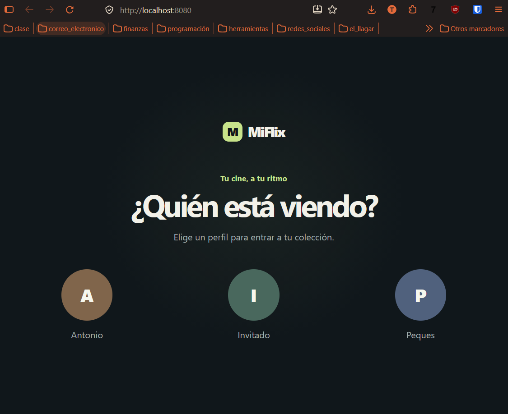 | 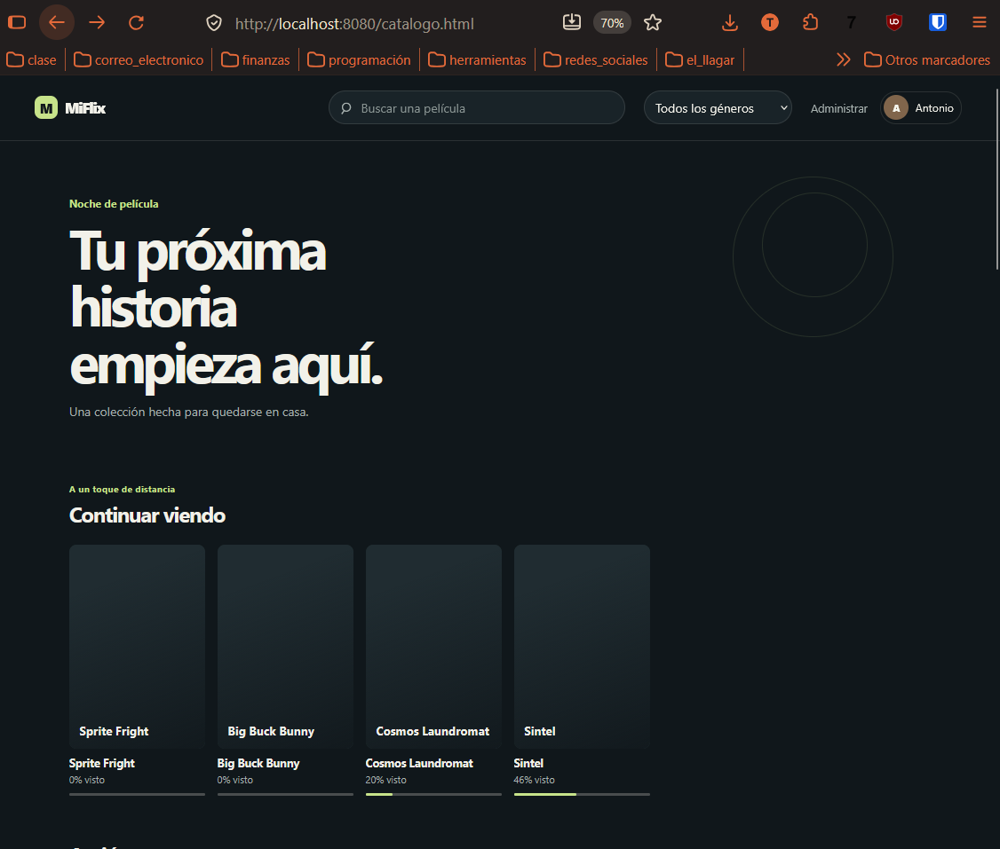 |

| Detalle | Reproductor |
|---|---|
| 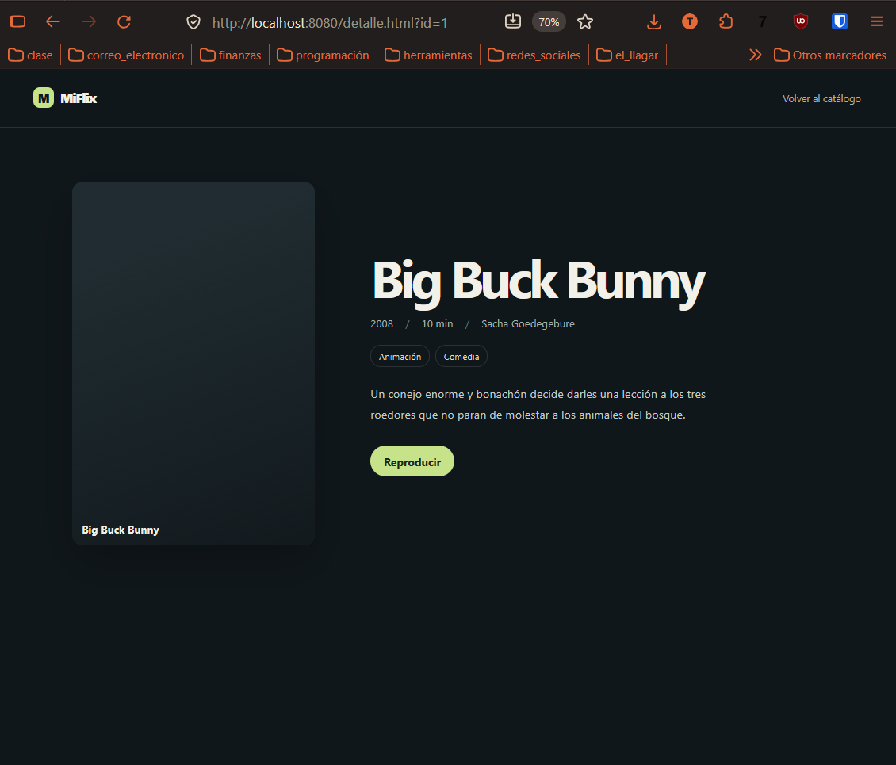 | 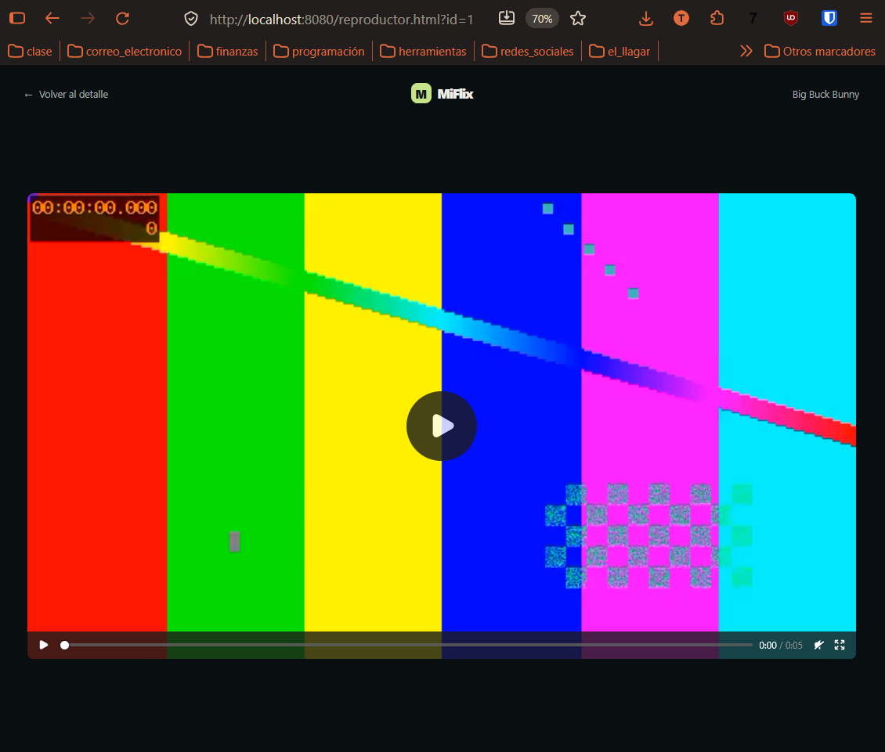 |

| Panel de administración | Formulario de alta |
|---|---|
| 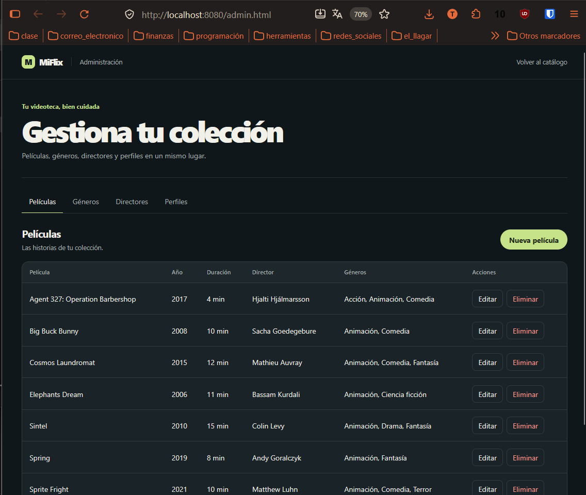 | 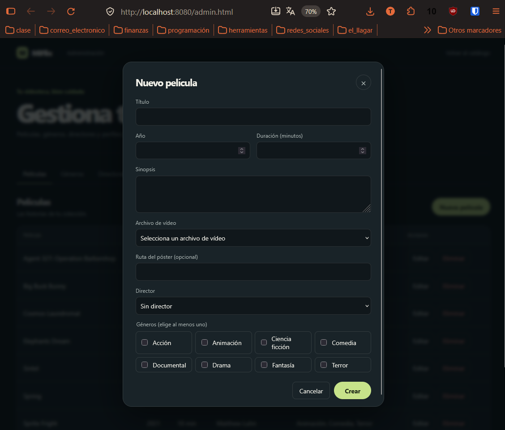 |

### Base de datos y streaming

| Tablas creadas por `init.sql` (Adminer) | Integridad referencial: `ON DELETE RESTRICT` |
|---|---|
| 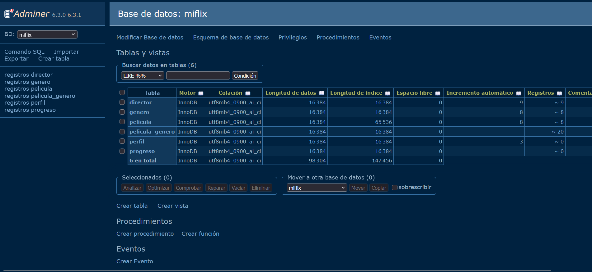 | 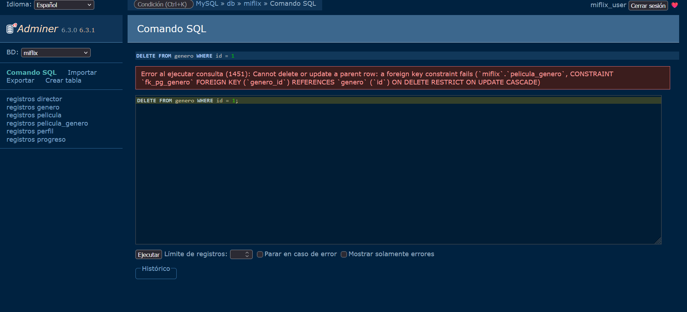 |

| Persistencia tras `docker compose down` / `up` | Streaming directo con HTTP Range |
|---|---|
| 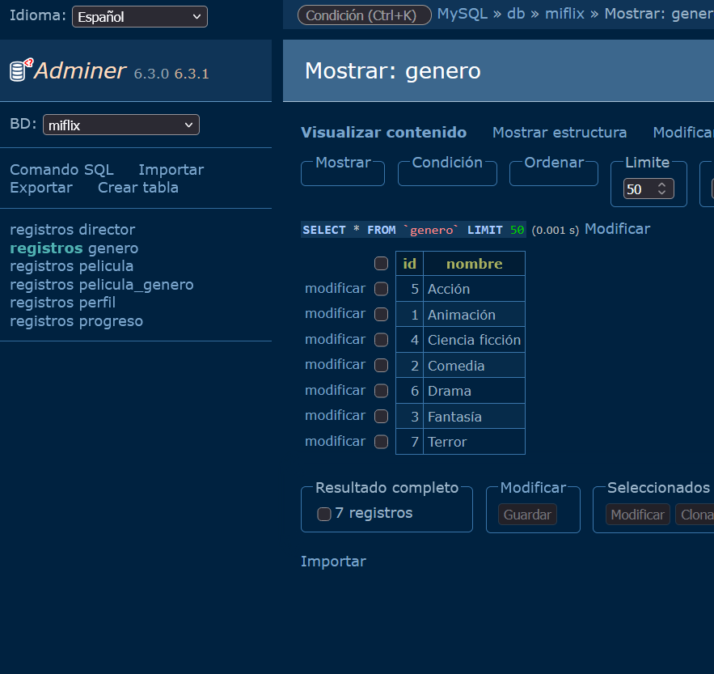 | 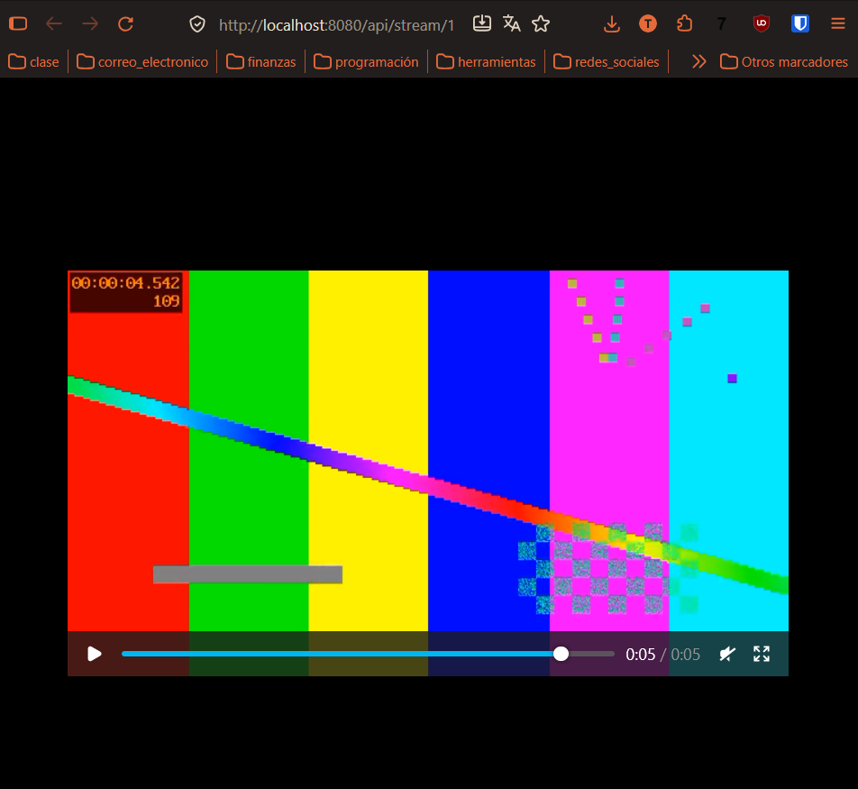 |

> En la captura de persistencia, el género "Documental" (id 8) se borró, se ejecutó `docker compose down` y `docker compose up -d`, y sigue sin aparecer: los datos se conservan en el volumen nombrado `db_data`.

---

## Tecnologías

| Capa | Tecnología |
|---|---|
| Lenguaje y build | Java 21 (Eclipse Temurin), Maven, empaquetado `.war` |
| Servidor | Apache Tomcat 10.1 (Jakarta EE 10) |
| API REST | JAX-RS (Jersey 3.1) + Jackson |
| Acceso a datos | **JDBC puro** con `PreparedStatement` + pool de conexiones **HikariCP** |
| Base de datos | MySQL 8.4 |
| Frontend | HTML5 semántico, CSS3 y JavaScript vanilla (ES modules + `fetch`), sin dependencias externas |
| Tests | JUnit 5, Mockito y Testcontainers (MySQL real en Docker) |
| Despliegue | Docker (Dockerfile multi-stage) + Docker Compose |
| Administración de BD | Adminer |

---

## Arquitectura

### Capas de la aplicación

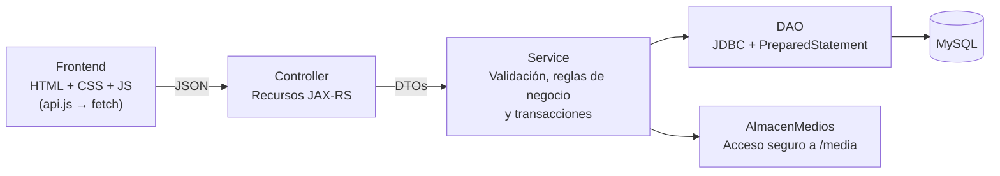

- **Controller** (`controller/`): recibe la petición HTTP, delega en el servicio y devuelve DTOs con códigos semánticos (200, 201 + `Location`, 204, 400, 404, 409, 416, 503). Sin lógica ni SQL.
- **Service** (`service/`): validaciones, reglas de negocio y **gestión transaccional** mediante `GestorTransacciones` (commit / rollback). Ejemplo: crear una película inserta en `pelicula` y en `pelicula_genero` dentro de la misma transacción.
- **DAO** (`dao/`): JDBC puro, siempre con `PreparedStatement` y try-with-resources. Los errores de MySQL se traducen a excepciones propias en `SQLExceptionTraductor` (1062 → duplicado, 1451/1452 → integridad referencial, 3819 → `CHECK`).
- **DTOs** (`dto/`): las entidades de `model/` nunca salen de la capa de servicio.
- **Errores**: excepciones propias y `ExceptionMapper` que devuelven siempre el mismo JSON (`status`, `error`, `mensaje`, `timestamp`), sin stacktraces.

### Contenedores

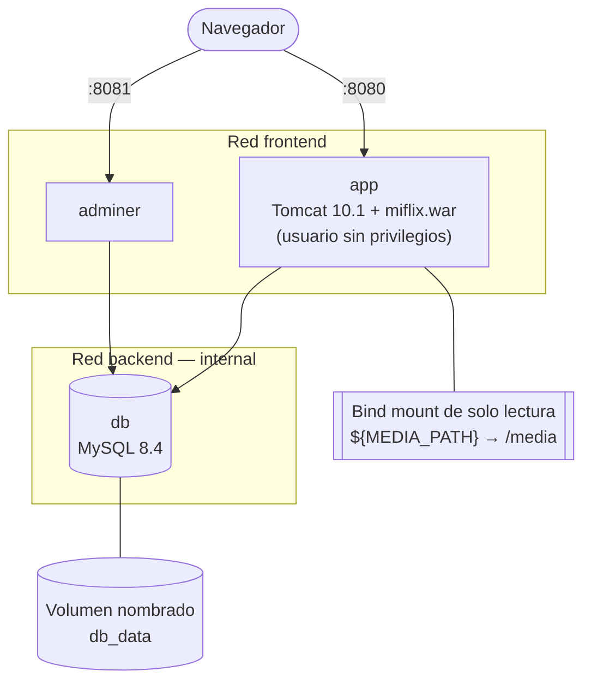

- **`app`**: imagen propia construida con un **Dockerfile multi-stage** (Maven compila el `.war` y Tomcat lo despliega como `ROOT.war`). Se ejecuta con un usuario sin privilegios.
- **`db`**: MySQL oficial. `init.sql` se ejecuta automáticamente en el primer arranque y los datos persisten en el **volumen nombrado `db_data`**. Tiene un **healthcheck**, y `app` y `adminer` esperan a que esté sano (`depends_on: condition: service_healthy`).
- **Red `backend` interna**: la base de datos no es accesible desde fuera de Docker.
- **Vídeos**: no se guardan en la BD ni en la imagen. Se montan desde una carpeta del equipo en **solo lectura**; la BD guarda solo la ruta relativa.

---

## Modelo de datos

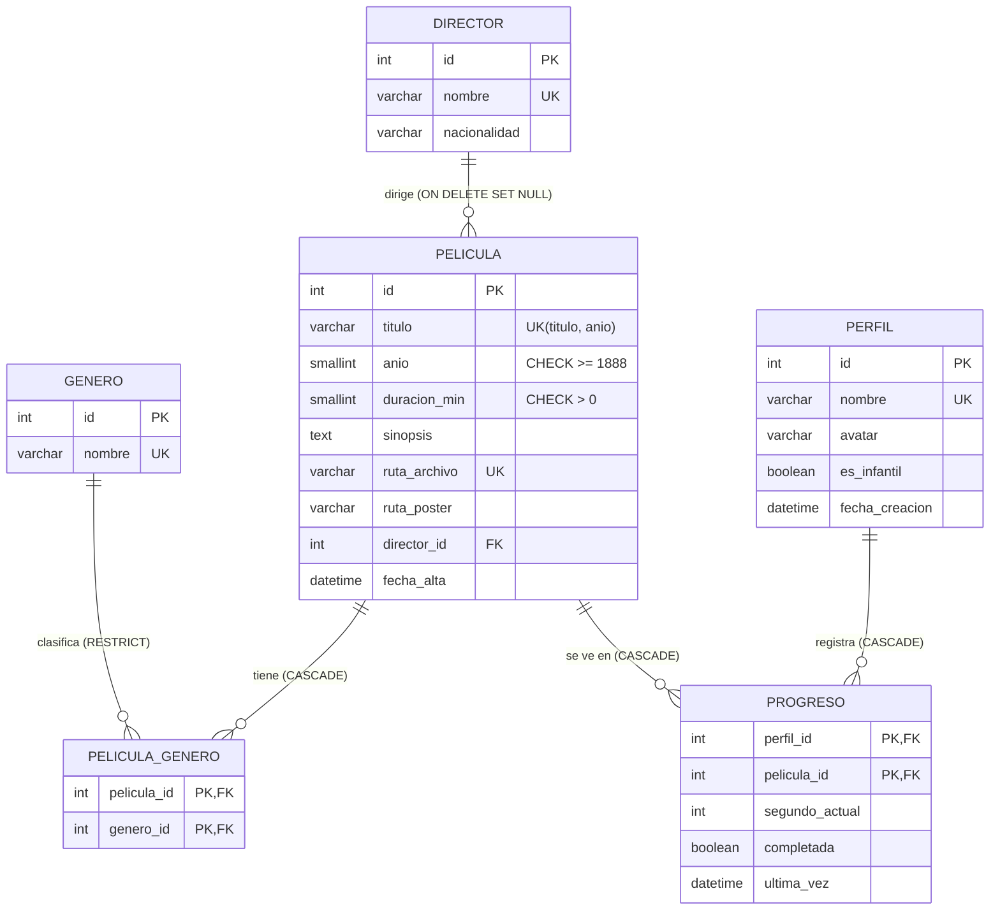

| Relación | Tipo | Regla de integridad | Comportamiento en la aplicación |
|---|---|---|---|
| Director → Película | **1:N** | `ON DELETE SET NULL` | Se puede borrar un director; sus películas quedan sin director |
| Película ↔ Género | **N:M** (`pelicula_genero`) | `CASCADE` en película, `RESTRICT` en género | No se puede borrar un género con películas (409) |
| Perfil ↔ Película | **N:M con atributos** (`progreso`) | `CASCADE` en ambos lados | Al borrar un perfil o una película se borra su progreso |

El script [`db/init.sql`](db/init.sql) contiene el DDL y datos de prueba: 8 películas (cortos libres de la Blender Foundation), 8 géneros, 9 directores, 3 perfiles y registros de progreso.

---

## Puesta en marcha

### Requisitos

- [Docker Desktop](https://www.docker.com/products/docker-desktop/) con Docker Compose v2.
- *(Solo para ejecutar los tests en local)* JDK 21 y Maven 3.9.

### 1. Clonar el repositorio

```bash
git clone <url-del-repositorio>
cd miflix
```

### 2. Crear el archivo `.env` a partir de la plantilla

```bash
# Linux / macOS
cp .env.example .env

# Windows (PowerShell)
Copy-Item .env.example .env
```

Abre `.env` y sustituye los valores `cambia_esto` por contraseñas propias (solo letras y números). `DB_USER` y `DB_PASSWORD` deben coincidir con `MYSQL_USER` y `MYSQL_PASSWORD`.

### 3. Añadir películas

Crea la carpeta indicada en `MEDIA_PATH` (por defecto `./media-demo`) y copia en ella los vídeos con los nombres que usa `init.sql`, por ejemplo:

```
media-demo/
├── big-buck-bunny.mp4
├── sintel.mp4
├── ...
└── posters/
    ├── big-buck-bunny.jpg
    └── ...
```

Los datos de prueba usan cortometrajes libres de la Blender Foundation (Big Buck Bunny, Sintel, Spring…), descargables legalmente desde su web. Formatos admitidos: **MP4 (H.264/AAC)** y **WebM**.

> Sin vídeos la aplicación funciona igual (catálogo, CRUD, API); solo falla la reproducción de las películas cuyo archivo no exista.

### 4. Desplegar

```bash
docker compose up --build -d
```

La primera vez tarda unos minutos: descarga las imágenes, compila el proyecto e inicializa la BD. Para comprobar el estado:

```bash
docker compose ps
```

Cuando `miflix-db` aparezca como **(healthy)**, abre **http://localhost:8080**.

### Comandos útiles

| Comando | Efecto |
|---|---|
| `docker compose logs -f app` | Ver los logs de la aplicación |
| `docker compose down` | Parar los contenedores **conservando los datos** |
| `docker compose down -v` | Parar y **borrar la BD** (al volver a arrancar se ejecuta `init.sql` de nuevo) |
| `docker compose up --build -d` | Reconstruir tras cambiar el código |

---

## Variables de entorno

Todas se definen en `.env` (no se sube al repositorio) y Docker Compose las inyecta en los contenedores. **Ninguna credencial está escrita en el código.**

| Variable | Usada por | Descripción | Ejemplo |
|---|---|---|---|
| `MYSQL_ROOT_PASSWORD` | db | Contraseña de root de MySQL | `RootMiflix2026` |
| `MYSQL_DATABASE` | db | Nombre de la base de datos | `miflix` |
| `MYSQL_USER` | db | Usuario de la aplicación | `miflix_user` |
| `MYSQL_PASSWORD` | db | Contraseña del usuario | `MiflixPass2026` |
| `DB_URL` | app | URL JDBC (el host es el nombre del servicio) | `jdbc:mysql://db:3306/miflix` |
| `DB_USER` | app | Igual que `MYSQL_USER` | `miflix_user` |
| `DB_PASSWORD` | app | Igual que `MYSQL_PASSWORD` | `MiflixPass2026` |
| `MEDIA_PATH` | compose | Carpeta **del equipo** con los vídeos; se monta en `/media` | `./media-demo` |
| `APP_PORT` | compose | Puerto de la aplicación en el equipo | `8080` |
| `ADMINER_PORT` | compose | Puerto de Adminer en el equipo | `8081` |

Si falta alguna variable obligatoria, la aplicación no arranca y el log indica cuál.

---

## Puertos y credenciales

| Servicio | URL | Acceso |
|---|---|---|
| **MiFlix** | http://localhost:8080 | Sin login: se elige un perfil (Antonio, Invitado o Peques) |
| Panel de administración | http://localhost:8080/admin.html | Enlace "Administrar" desde el catálogo |
| Estado del servicio | http://localhost:8080/api/health | — |
| **Adminer** | http://localhost:8081 | Sistema: **MySQL** · Servidor: **db** · Usuario y contraseña: `MYSQL_USER` / `MYSQL_PASSWORD` del `.env` · Base de datos: **miflix** |
| MySQL | *(no expuesto)* | Solo accesible desde la red interna de Docker |

---

## Manual de uso

1. **Elegir perfil.** Al entrar aparece "¿Quién está viendo?". El perfil elegido se recuerda en el navegador.
2. **Explorar el catálogo.** Las películas se agrupan en filas por género. Puedes:
   - buscar por título (la búsqueda se lanza al dejar de escribir),
   - filtrar por género con el selector,
   - ver la fila **Continuar viendo**, con la barra de progreso de cada película empezada.
3. **Ver el detalle.** Pulsa una película para ver su sinopsis, año, duración, director y géneros.
4. **Reproducir.** El botón **Reproducir** (o **Continuar** si ya la empezaste) abre el reproductor. Puedes saltar a cualquier punto al instante. El progreso se guarda automáticamente cada 10 segundos, al pausar y al salir; al llegar al 90 % la película se marca como vista.
5. **Administrar** (`admin.html`). Pestañas de **Películas, Géneros, Directores y Perfiles** con alta, edición y borrado:
   - Al crear una película, el archivo de vídeo se elige de un desplegable con los vídeos que hay en la carpeta de medios, marcando los ya registrados.
   - Antes de borrar se explican las consecuencias (por ejemplo, que las películas de un director quedarán sin director).
   - Los errores de validación y los conflictos los muestra el propio servidor (por ejemplo: *"No se puede eliminar el género Animación porque tiene 7 películas asociadas"*).

**Reglas de negocio principales:**
- Película: título obligatorio, año entre 1888 y el actual, duración de 1 a 999 min, al menos un género, archivo `.mp4`/`.webm` existente dentro de la carpeta de medios. No puede repetirse el título + año ni el archivo.
- Máximo **5 perfiles**.
- No se puede borrar un género con películas asociadas.

---

## API REST

Todas las rutas cuelgan de `/api`, aceptan y devuelven JSON. Los errores tienen siempre el formato:

```json
{ "status": 409, "error": "Conflict", "mensaje": "Ya existe un género con el nombre 'Drama'.", "timestamp": "2026-11-27T12:00:00Z" }
```

| Método | Ruta | Respuestas |
|---|---|---|
| GET | `/health` | 200 UP · 503 si la BD no responde |
| GET | `/peliculas?q=&generoId=&directorId=` | 200 (filtros opcionales y combinables) |
| GET | `/peliculas/{id}` | 200 · 404 |
| POST | `/peliculas` | 201 + `Location` · 400 · 409 |
| PUT | `/peliculas/{id}` | 200 · 400 · 404 · 409 |
| DELETE | `/peliculas/{id}` | 204 · 404 |
| GET · POST · PUT · DELETE | `/generos`, `/directores`, `/perfiles` (y `/{id}`) | Mismos códigos; borrar un género con películas → 409; 6.º perfil → 409 |
| GET | `/perfiles/{id}/continuar-viendo` | 200 |
| GET · PUT | `/perfiles/{perfilId}/progreso/{peliculaId}` | 200 · 400 · 404 |
| GET | `/stream/{peliculaId}` | 200 completo · **206 Partial Content** con `Range` · 416 · 404 |
| GET | `/posters/{peliculaId}` | 200 (caché 24 h) · 404 |
| GET | `/medios/videos` | 200 (vídeos de la carpeta de medios e indicador "registrado") |

La carpeta [`http/`](http/) contiene peticiones listas para ejecutar con el cliente HTTP de IntelliJ, con un caso por cada respuesta posible.

---

## Tests

```bash
mvn test
```

> Requiere **Docker en marcha**: los tests de integración de los DAO levantan un MySQL 8.4 real con **Testcontainers** y cargan `init.sql` antes de cada test.

**176 tests** organizados en:

| Tipo | Herramienta | Qué cubre |
|---|---|---|
| Integración de DAO | JUnit 5 + Testcontainers | CRUD de todas las entidades contra MySQL real, clave duplicada, registro inexistente, `CHECK`, FK inexistente, `SET NULL` y `CASCADE` |
| Transacciones | JUnit 5 + Testcontainers / Mockito | **Rollback real**: crear una película con un género inexistente no deja datos; commit, rollback, restauración de `autoCommit` y fallo del propio rollback |
| Servicios | JUnit 5 + Mockito | Todas las validaciones con sus valores límite, duplicados → 409, inexistentes → 404, límite de perfiles, regla del 90 %, path traversal |
| Utilidades | JUnit 5 | Traducción de errores SQL, parseo de cabeceras `Range`, mapeo de excepciones a HTTP, configuración |

Además, cada fase se verificó desplegando en Docker con una tabla de peticiones (código esperado frente a obtenido), documentada en [`AI_WORKFLOW.md`](AI_WORKFLOW.md).

---

## Estructura del proyecto

```
miflix/
├── .junie/guidelines.md        # Reglas de trabajo para el agente Junie
├── db/init.sql                 # DDL + datos de prueba (se ejecuta al crear la BD)
├── docs/img/                   # Capturas del README
├── http/                       # Peticiones HTTP de prueba por entidad
├── src/main/java/com/antonio/miflix/
│   ├── config/                 # AppConfig, pool HikariCP, Jersey, Jackson, AlmacenMedios
│   ├── controller/             # Recursos REST (JAX-RS)
│   ├── service/                # Lógica de negocio, validación, transacciones, streaming
│   ├── dao/                    # JDBC, GestorTransacciones, SQLExceptionTraductor
│   ├── model/                  # Entidades y proyecciones de lectura
│   ├── dto/                    # Objetos de transferencia de la API
│   ├── mapper/                 # Conversión entidad ↔ DTO
│   └── exception/              # Excepciones propias y ExceptionMappers
├── src/main/webapp/            # Frontend (HTML, css/, js/)
├── src/test/java/              # Tests JUnit 5
├── tomcat/server.xml           # Oculta stacktraces y versión de Tomcat en los errores
├── Dockerfile                  # Build multi-stage (Maven → Tomcat)
├── docker-compose.yml          # Servicios app, db y adminer
├── .env.example                # Plantilla de configuración
├── AI_WORKFLOW.md              # Registro del trabajo con Junie
└── README.md
```

---

**Autor:** Antonio Jacob Pérez · 2.º DAM · DigiTech Madrid · 2026
